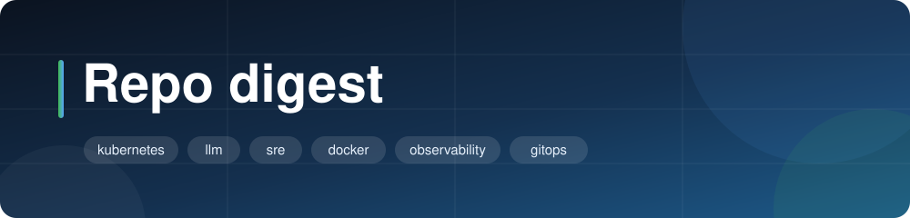

<div align="center">



**[Website](https://bilalkhanten.github.io/ai-digest/)** · **[Contribute](https://bilalkhanten.github.io/ai-digest/contribute.html)** · **[Stats](https://bilalkhanten.github.io/ai-digest/stats.html)** · **[RSS](https://bilalkhanten.github.io/ai-digest/feed.xml)** · **[Index](INDEX.md)** · **[Packages](https://github.com/Bilalkhanten?tab=packages&repo_name=ai-digest)** · **[Incident copilot](copilot/)**

[](https://github.com/Bilalkhanten/ai-digest/actions/workflows/ci.yml)
[](https://github.com/Bilalkhanten/ai-digest/actions/workflows/daily-fork.yml)
[](https://github.com/Bilalkhanten/ai-digest/actions/workflows/copilot-ci.yml)
[](https://github.com/Bilalkhanten/ai-digest/actions/workflows/copilot-publish.yml)
[](https://github.com/Bilalkhanten/ai-digest/actions/workflows/data-check.yml)
[](https://github.com/Bilalkhanten/ai-digest/actions/workflows/watchdog.yml)
[](https://github.com/Bilalkhanten/ai-digest/actions/workflows/weekly-rollup.yml)
[](https://github.com/Bilalkhanten/ai-digest/actions/workflows/scorecard.yml)
[](https://github.com/Bilalkhanten/ai-digest/actions/workflows/token-health.yml)
[](https://github.com/Bilalkhanten/ai-digest/actions/workflows/fork-inventory.yml)


</div>

**OSS Signal Pipeline** is a scheduled data pipeline I built to track notable open-source projects across
AI, Kubernetes, DevOps, SRE and monitoring. It discovers candidates through the GitHub Search API,
scores them on star velocity, push recency and release freshness, enriches each pick with README
facts, release notes, security advisories and open contribution opportunities, and publishes the
results as Markdown in git, a static site with RSS feeds, and open JSON data.
[INDEX.md](INDEX.md) is the running log.

## Highlights

- **Discovery and scoring.** Rotating topics are searched through the GitHub Search API. Candidates are weighted by star velocity, push recency and release freshness, with an owner cooldown and weighted randomness so the output stays varied.
- **Enrichment.** README excerpt, install command and sections, release notes, security advisories and open beginner-friendly issues. Rule-based, standard-library Python; all third-party text is treated as untrusted and sanitised.
- **Publishing.** Git is the datastore (`forked.json` plus Markdown reports). A static site adds filters, search, per-area RSS feeds, stats, a Contribute page and open JSON data. Each selected project is also forked with a least-privilege token.
- **Reliability engineering.** Test-gated runs, idempotent scheduling with backup slots, a watchdog that repairs skipped runs, a nightly data-validation job, self-closing alert issues and token-expiry monitoring.
- **Supply-chain hygiene.** Least-privilege permissions per job, SHA-pinned actions, and a sole-author check in CI.
- **An incident copilot.** [`copilot/`](copilot/) is a read-only Kubernetes and Prometheus triage tool in TypeScript, published as an npm package and a container image. It has its own CI and never affects the pipeline's runs.

## Pipeline

| Workflow | Trigger | What it does |
|---|---|---|
| **CI** (`ci.yml`) | every push, PRs to `main` | offline tests on Python 3.10 to 3.13, `ruff`, `shellcheck`, `actionlint`, `mypy` with a 90% coverage floor, and a sole-author check (only the identities in `.github/allowed-authors.txt`, no `Co-authored-by`) |
| **Daily pipeline run** (`daily-fork.yml`) | 07:17 UTC daily, with backup slots at 13:43 and 19:29 UTC, manual | `verify` (tests) gates `fork` (discover, score, fork, commit the report). On failure it opens one issue; the next success closes it |
| **Copilot CI** (`copilot-ci.yml`) | pushes and PRs that touch `copilot/` | builds and tests the TypeScript incident copilot on Node 22 and 24, and replays its demo. Independent of the daily run |
| **Copilot publish** (`copilot-publish.yml`) | a `copilot-vX.Y.Z` tag; manual run is a dry run | publishes the incident copilot as an npm package and a container image on GitHub Packages. Never runs on normal pushes |
| **Scorecard** (`scorecard.yml`) | pushes to `main`, Tuesdays 05:17 UTC | OpenSSF Scorecard of the repo's supply-chain practices (pinned actions, least-privilege tokens, branch protection), uploaded to the Security tab |
| **Token health** (`token-health.yml`) | Mondays 06:43 UTC, manual | checks `FORK_PAT` is valid, has only `public_repo`, and is not within 14 days of expiry; opens an issue if not |
| **Weekly roll-up** (`weekly-rollup.yml`) | Sundays 18:23 UTC, manual | writes `digest/weekly/YYYY-Www.md` (repos, topic and language counts, optional Claude themes) and commits it |
| **Data check** (`data-check.yml`) | daily 03:41 UTC, manual, and in CI | validates `forked.json`, the digest pages, `INDEX.md`, weekly pages and `config.json`; opens an issue if anything is inconsistent |
| **Watchdog** (`watchdog.yml`) | daily 12:07 and 18:47 UTC, manual | if today's digest is missing it starts the daily workflow itself (a repair for skipped schedules), and opens an issue if the newest digest is 2+ days old |
| **Fork inventory** (`fork-inventory.yml`) | 1st of the month, manual | posts a read-only report of the forks this tool made, with candidates to prune. It never deletes anything |
| **Publish site** (job in `daily-fork.yml`) | after each real run, if enabled | builds a small website and RSS feed from the digests. Off by default, see below |
| **Dependabot** | monthly | keeps the GitHub Actions versions current. Actions are pinned to commit SHAs |

After a real run pushes its commit, the `notify` job @mentions you on a single
running issue, "Pipeline run log". GitHub emails you for that mention (and pushes to the
GitHub mobile app). Failures and token problems @mention you too. For emails, check
Settings > Notifications > "Participating, @mentions and custom" has Email ticked. To
stop them, mute the issue or delete the `notify` job.

Each run also writes a summary (what was picked or forked) to the job page.
The API client retries transient errors (429, 5xx, network) up to 3 times.

## Run your own copy (about 10 minutes)

1. **Create a public repo** on GitHub called `ai-digest` (default branch `main`)
   and upload everything in this folder, including the hidden `.github` folder.
2. **Create a token**: GitHub > Settings > Developer settings > Personal access
   tokens > Tokens (classic) > Generate new token. Tick only the `public_repo`
   scope and set an expiry (90 days is a sensible choice; calendar a renewal).
3. **Add secrets** in the repo under Settings > Secrets and variables > Actions:
   - `FORK_PAT` (required): the token from step 2.
   - `ANTHROPIC_API_KEY` (optional): from the Anthropic Console. Enables a short
     Claude-written summary in each digest. Without it the digest still lists the
     repo's metadata. This is API usage, billed separately from a claude.ai plan;
     one small summary a day costs very little.
4. **Test it**: Actions tab > "Daily pipeline run" > Run workflow, and tick
   `dry_run`. The log shows the repo it would pick. Then run it again with
   `dry_run` unticked to fork and commit for real.
5. **Check the result** after a run: the job summary, the new page under `digest/`, and
   the website if you enabled it. Dates are in UTC.

## Notes

- Commits are authored with your GitHub noreply address (`ID+login@users.noreply.github.com`),
  so they are attributed to your account without exposing an email address.
- GitHub disables scheduled workflows in a public repo after 60 days without
  repo activity. The daily commit should keep it active; check the
  Actions tab now and then.
- Tuning (environment variables in the workflow): `MIN_STARS` (default 100),
  `MAX_AGE_DAYS` (default 30), `CLAUDE_MODEL`.
- It forks once a day and keeps `default_branch_only` on to stay light. Don't
  raise the frequency; GitHub's acceptable-use rules target bulk automated activity.
- Revoke the token if you stop using this. To renew it, regenerate it and update the
  `FORK_PAT` secret; the Token health workflow warns you 14 days ahead.

## What each report contains

Every page is built from the repo's own data, with no API key and no cost: name, description,
stars, language, license, last push, topics, age, forks, open issues and the latest release,
plus an **At a glance** section with a short README excerpt, the first install command found
in the README, and the README's main sections. When the repo has a recent release, its first few
release-note lines appear as **What's new**, and if it has published security advisories, a
one-line summary of them (count, highest severity, latest date) is shown. Both are public data. Badges, HTML, links and `@` mentions are
stripped from the excerpt. If you add `ANTHROPIC_API_KEY`, a Claude-written 3-bullet summary
is added on top; that part is optional.

Each page can also have a **Contribution opportunities** section: up to three open issues labelled
`good first issue` or `help wanted` (not assigned, not locked, active in the last 180 days), each
with a link, plus the repo's CONTRIBUTING guide. The tool only lists them. It never comments,
opens pull requests or touches anyone else's repository. If you want to work on one, pick it and
do it yourself in your fork (or ask for help with it in a session). Titles are untrusted text and
are cleaned before they are written.

The website also has a **Contribute** page (`contribute.html`): the same kind of issues gathered
from the 40 newest picks, grouped by repo and rebuilt on every publish, so you can find something
to work on without waiting for a pick. Issues that were closed or assigned since are dropped on
the next rebuild.

## Configuration

Settings live in `config.json`; environment variables (`MIN_STARS`, `MAX_AGE_DAYS`,
`FORK_EVERY_DAYS`) override them. All keys are optional.

| Key | Default | Meaning |
|---|---|---|
| `areas` | AI, Platform | which topics belong to which area; drives the website's area filter and per-area RSS feeds |
| `topics` | 36 topics | rotated by day of year; AI and platform topics (Kubernetes, DevOps, Docker, SRE, monitoring, observability, Terraform, GitOps...) are interleaved so the feed alternates |
| `min_stars` / `max_age_days` | 100 / 30 | popularity floor, and how recently the repo was pushed |
| `fork_every_days` | 1 | `1` daily, `7` weekly, `0` never (digest only) |
| `min_readme_chars` | 500 | skip repos with a stub README |
| `owner_cooldown_days` | 21 | avoid picking the same owner again within this many days |
| `release_bonus_days` / `release_check_top` | 30 / 6 | among the first N candidates, those with a release this recent go first |
| `contribution_labels` | `good first issue`, `help wanted` | issue labels to list, best first |
| `max_opportunities` / `opportunity_max_age_days` | 3 / 180 | how many issues to list (0 turns the section off), and how recently they were active |
| `include_languages` / `exclude_languages` | empty | only pick these languages (e.g. `["Python", "Go"]`), or never pick these; names match GitHub's, case-insensitively |
| `exclude_repos`, `exclude_owners` | empty | never pick these (`owner/name`, owner login) |
| `exclude_name_patterns` | `^awesome`, `interview`, `roadmap` | regexes matched against the repo name |
| `exclude_description_keywords` | curated list, awesome list, ... | skip if the description contains any |

Picks are random but weighted by a score of how interesting a repo is right now: stars, how
fast it has been gaining them (stars per day since creation), and how recently it was pushed.
Among the first few candidates, ones with a recent release go first, and an owner picked in the
last 21 days is skipped when there is another choice. Each digest says why it was picked, for
example `1,772 stars, ~19.7 stars/day since creation, pushed today, release 4 days ago`.

If a digest-only
day happens (`fork_every_days` above 1), the digest and its commit are still written;
only the fork is skipped.

## Website and RSS feed (optional)

The digest can be published as a small site with an RSS feed. It is off until you enable it:

1. Repo Settings > Pages > Build and deployment > Source: **GitHub Actions**.
2. Repo Settings > Secrets and variables > Actions > Variables > New repository variable:
   `ENABLE_PAGES` = `true`.

The site can be filtered by **area** (AI or Platform) and by topic, and offers a separate RSS feed
for each area (`feed-ai.xml`, `feed-platform.xml`), the combined `feed.xml`, and `feed-weekly.xml` with
one item per weekly roll-up.

The site has a **Stats** page (streaks, picks per week, by topic and language, and a
"where are they now" table comparing each pick's stars then and now; charts are plain SVG)
and an **Open data** file, `digests.json`, with one record per pick.

After the next real run the site appears at `https://<your-login>.github.io/ai-digest/`,
with the feed at `.../feed.xml`. Preview locally with `python3 scripts/build_site.py site`.

## Protect main (optional)

`.github/rulesets/protect-main.json` blocks force-pushes and deletion of `main`. It does not
require pull requests or checks, so the daily commit still works. To apply it: repo
Settings > Rules > Rulesets > New ruleset > Import a ruleset, then choose that file.
If you ever need to rewrite history, disable the ruleset first.

## Develop

```bash
python3 -m unittest discover -s tests -v   # offline; never contacts GitHub
pip install ruff && ruff check .
```

## Run locally

```bash
DRY_RUN=1 python3 scripts/daily_fork.py        # pick only, no token needed
GH_TOKEN=ghp_xxx python3 scripts/daily_fork.py  # fork and write files
```
