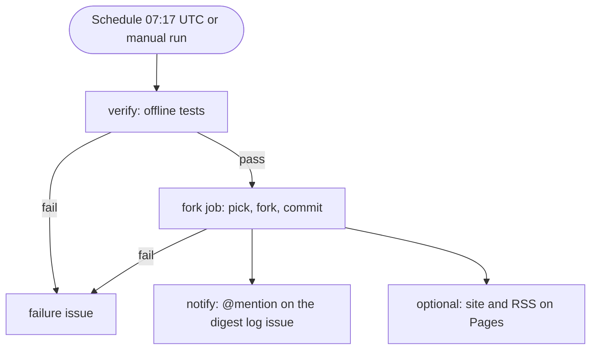

# Repo digest

[](https://github.com/Bilalkhanten/ai-digest/actions/workflows/ci.yml)
[](https://github.com/Bilalkhanten/ai-digest/actions/workflows/daily-fork.yml)

Every day a GitHub Actions workflow picks one popular, recently active open-source repo
(rotating topics across AI, Kubernetes, DevOps, SRE, monitoring and more), forks it into your
account, and commits a short digest entry to this repo. The digest commit counts
toward your contribution graph. See [INDEX.md](INDEX.md) for the log.

## Latest picks

<!-- LATEST-PICKS:START -->
| Date | Repo | Stars | Topic |
|---|---|---|---|
| 2026-11-17 | [smol-machines/smolvm](https://github.com/smol-machines/smolvm) | 7,127 | containers |
| 2026-11-16 | [EverMind-AI/Raven](https://github.com/EverMind-AI/Raven) | 6,225 | llm |
<!-- LATEST-PICKS:END -->

## How it works



Design notes, the data flow, known limits and a runbook are in
[docs/ARCHITECTURE.md](docs/ARCHITECTURE.md).

## Pipeline

| Workflow | Trigger | What it does |
|---|---|---|
| **CI** (`ci.yml`) | every push, PRs to `main` | offline tests on Python 3.10 to 3.13, `ruff`, `shellcheck`, `actionlint`, and a sole-author check (only the identities in `.github/allowed-authors.txt`, no `Co-authored-by`) |
| **Daily repo fork** (`daily-fork.yml`) | 07:17 UTC daily, manual | `verify` (tests) gates `fork` (pick, fork, commit digest). On failure it opens one issue; the next success closes it |
| **Token health** (`token-health.yml`) | Mondays 06:43 UTC, manual | checks `FORK_PAT` is valid, has only `public_repo`, and is not within 14 days of expiry; opens an issue if not |
| **Weekly roll-up** (`weekly-rollup.yml`) | Sundays 18:23 UTC, manual | writes `digest/weekly/YYYY-Www.md` (repos, topic and language counts, optional Claude themes) and commits it |
| **Data check** (`data-check.yml`) | daily 03:41 UTC, manual, and in CI | validates `forked.json`, the digest pages, `INDEX.md`, the README block, weekly pages and `config.json`; opens an issue if anything is inconsistent |
| **Watchdog** (`watchdog.yml`) | daily 12:07 UTC, manual | opens an issue if the newest digest is 2+ days old (a skipped or failing schedule) |
| **Fork inventory** (`fork-inventory.yml`) | 1st of the month, manual | posts a read-only report of the forks this tool made, with candidates to prune. It never deletes anything |
| **Publish site** (job in `daily-fork.yml`) | after each real run, if enabled | builds a small website and RSS feed from the digests. Off by default, see below |
| **Dependabot** | monthly | keeps the GitHub Actions versions current. Actions are pinned to commit SHAs |

After a real run pushes a digest commit, the `notify` job @mentions you on a single
running issue, "Daily digest log". GitHub emails you for that mention (and pushes to the
GitHub mobile app). Failures and token problems @mention you too. This confirms the
commit was pushed; the contribution graph itself can lag behind. For emails, check
Settings > Notifications > "Participating, @mentions and custom" has Email ticked. To
stop them, mute the issue or delete the `notify` job.

Each run also writes a summary (what was picked or forked) to the job page.
The API client retries transient errors (429, 5xx, network) up to 3 times.

## Setup (about 10 minutes)

1. **Create a public repo** on GitHub called `ai-digest` (default branch `main`)
   and upload everything in this folder, including the hidden `.github` folder.
2. **Create a token**: GitHub > Settings > Developer settings > Personal access
   tokens > Tokens (classic) > Generate new token. Tick only the `public_repo`
   scope and set an expiry (90 days is a sensible choice; calendar a renewal).
3. **Add secrets** in the repo under Settings > Secrets and variables > Actions:
   - `FORK_PAT` (required): the token from step 2.
   - `ANTHROPIC_API_KEY` (optional): from the Anthropic Console. Enables a short
     Claude-written summary in each digest. Without it the digest still lists the
     repo's metadata. This is API usage, billed separately from a claude.ai plan;
     one small summary a day costs very little.
4. **Test it**: Actions tab > "Daily repo fork" > Run workflow, and tick
   `dry_run`. The log shows the repo it would pick. Then run it again with
   `dry_run` unticked to fork and commit for real.
5. **Check your profile** after a run. The contribution graph can lag, and dates
   are in UTC.

## Notes

- The commit author is set to your GitHub noreply address (`ID+login@users.noreply.github.com`),
  which is what lets the commit count toward your graph.
- The graph counts commits to a repo's default branch made with an email linked to
  your account. Forks are not a documented contribution type, so don't rely on them
  to add squares; commits made inside a fork do not count either.
- GitHub disables scheduled workflows in a public repo after 60 days without
  repo activity. The daily digest commit should keep it active; check the
  Actions tab now and then.
- Tuning (environment variables in the workflow): `MIN_STARS` (default 100),
  `MAX_AGE_DAYS` (default 30), `CLAUDE_MODEL`.
- It forks once a day and keeps `default_branch_only` on to stay light. Don't
  raise the frequency; GitHub's acceptable-use rules target bulk automated activity.
- Revoke the token if you stop using this. To renew it, regenerate it and update the
  `FORK_PAT` secret; the Token health workflow warns you 14 days ahead.

## What each digest page contains

Every page is built from the repo's own data, with no API key and no cost: name, description,
stars, language, license, last push, topics, age, forks, open issues and the latest release,
plus an **At a glance** section with a short README excerpt, the first install command found
in the README, and the README's main sections. When the repo has a recent release, its first few
release-note lines appear as **What's new**, and if it has published security advisories, a
one-line summary of them (count, highest severity, latest date) is shown. Both are public data. Badges, HTML, links and `@` mentions are
stripped from the excerpt. If you add `ANTHROPIC_API_KEY`, a Claude-written 3-bullet summary
is added on top; that part is optional.

## Configuration

Settings live in `config.json`; environment variables (`MIN_STARS`, `MAX_AGE_DAYS`,
`FORK_EVERY_DAYS`) override them. All keys are optional.

| Key | Default | Meaning |
|---|---|---|
| `areas` | AI, Platform | which topics belong to which area; drives the website's area filter and per-area RSS feeds |
| `topics` | 36 topics | rotated by day of year; AI and platform topics (Kubernetes, DevOps, Docker, SRE, monitoring, observability, Terraform, GitOps...) are interleaved so the feed alternates |
| `min_stars` / `max_age_days` | 100 / 30 | popularity floor, and how recently the repo was pushed |
| `fork_every_days` | 1 | `1` daily, `7` weekly, `0` never (digest only) |
| `min_readme_chars` | 500 | skip repos with a stub README |
| `owner_cooldown_days` | 21 | avoid picking the same owner again within this many days |
| `release_bonus_days` / `release_check_top` | 30 / 6 | among the first N candidates, those with a release this recent go first |
| `exclude_repos`, `exclude_owners` | empty | never pick these (`owner/name`, owner login) |
| `exclude_name_patterns` | `^awesome`, `interview`, `roadmap` | regexes matched against the repo name |
| `exclude_description_keywords` | curated list, awesome list, ... | skip if the description contains any |

Picks are random but weighted by a score of how interesting a repo is right now: stars, how
fast it has been gaining them (stars per day since creation), and how recently it was pushed.
Among the first few candidates, ones with a recent release go first, and an owner picked in the
last 21 days is skipped when there is another choice. Each digest says why it was picked, for
example `1,772 stars, ~19.7 stars/day since creation, pushed today, release 4 days ago`.

If a digest-only
day happens (`fork_every_days` above 1), the digest and its commit are still written;
only the fork is skipped.

## Website and RSS feed (optional)

The digest can be published as a small site with an RSS feed. It is off until you enable it:

1. Repo Settings > Pages > Build and deployment > Source: **GitHub Actions**.
2. Repo Settings > Secrets and variables > Actions > Variables > New repository variable:
   `ENABLE_PAGES` = `true`.

The site can be filtered by **area** (AI or Platform) and by topic, and offers a separate RSS feed
for each area (`feed-ai.xml`, `feed-platform.xml`), the combined `feed.xml`, and `feed-weekly.xml` with
one item per weekly roll-up.

The site has a **Stats** page (streaks, picks per week, by topic and language, and a
"where are they now" table comparing each pick's stars then and now; charts are plain SVG)
and an **Open data** file, `digests.json`, with one record per pick.

After the next real run the site appears at `https://<your-login>.github.io/ai-digest/`,
with the feed at `.../feed.xml`. Preview locally with `python3 scripts/build_site.py site`.

## Protect main (optional)

`.github/rulesets/protect-main.json` blocks force-pushes and deletion of `main`. It does not
require pull requests or checks, so the daily commit still works. To apply it: repo
Settings > Rules > Rulesets > New ruleset > Import a ruleset, then choose that file.
If you ever need to rewrite history, disable the ruleset first.

## Develop

```bash
python3 -m unittest discover -s tests -v   # offline; never contacts GitHub
pip install ruff && ruff check .
```

## Run locally

```bash
DRY_RUN=1 python3 scripts/daily_fork.py        # pick only, no token needed
GH_TOKEN=ghp_xxx python3 scripts/daily_fork.py  # fork and write files
```
