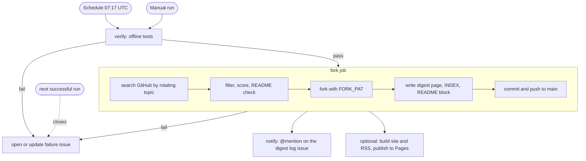
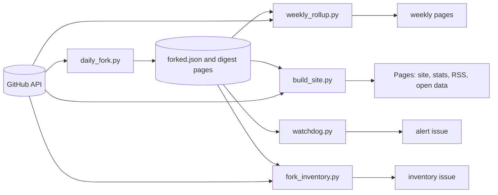

# Architecture

A small, boring-on-purpose system: one Python script per job, plain files as the database, and
GitHub Actions as the scheduler and runtime. Everything is standard-library Python.

## The daily run

## Data flow

Git is the database. `forked.json` is the state, `digest/YYYY-MM-DD.md` are the pages, and every
change is a commit, so the history is the audit log and a same-day rerun is a no-op.

## Workflows

| Workflow | When | Job |
|---|---|---|
| CI | every push and PR | tests on Python 3.10 to 3.13, ruff, shellcheck, actionlint |
| Daily repo fork | 07:17 UTC | tests gate the fork; pick, fork, commit; notify; optional site publish |
| Weekly roll-up | Sundays 18:23 UTC | weekly page with topic, language and star-gain stats |
| Watchdog | daily 12:07 UTC | opens an issue if no digest for 2+ days |
| Token health | Mondays 06:43 UTC | checks the token's validity, scopes and expiry |
| Fork inventory | 1st of the month | read-only report of forks made by the tool |

## Design decisions

- **Tests gate the fork.** A broken script must never fork or commit. The `verify` job runs the
  offline suite first and the fork job depends on it.
- **Failures are loud, and heal themselves.** A failed run opens one issue and `@mentions` the
  owner; the next success closes it. The watchdog catches the case where nothing runs at all.
- **Unknown is not a strike.** If a README or release lookup fails (rate limit, network), the
  candidate is kept. Only a genuinely missing README or a stub counts against a repo.
- **Weighted randomness, not a leaderboard.** Picks are random but weighted by stars, growth and
  push recency, with a release bonus and an owner cooldown, so the feed stays varied.
- **Least privilege everywhere.** Workflows start with no permissions; each job asks for the
  minimum. First-party actions are pinned to commit SHAs and kept current by Dependabot. The
  token is a classic PAT with only `public_repo`, and its expiry is monitored.
- **Independent concurrency groups.** Each workflow queues on its own, so one stuck run cannot
  block another.
- **Protect history, not the workflow.** The `main` ruleset blocks force-pushes and deletion but
  does not require pull requests, because the bot commits straight to `main`.
- **Rule-based summaries instead of an LLM.** The "At a glance" section (README excerpt, install
  command, sections, release notes, security advisories) uses only public repo data. GitHub Models
  was retired and free LLM tiers carry data-use and regional terms, so an LLM summary is optional
  and off by default (set `ANTHROPIC_API_KEY` to enable it).
- **No JavaScript required.** The website is static HTML; the filters are an enhancement and the
  page works without them.

## Known limits

- Scheduled workflows can be delayed or skipped by GitHub, and are paused after 60 days without
  repository activity; the daily commit and the watchdog cover this.
- The token expires (90 days by default) and has to be renewed by hand.
- The search API returns at most 100 repos per topic per call, and unauthenticated calls are heavily
  rate-limited, so every job uses a token.
- One fork a day adds up; the monthly inventory exists so old forks can be pruned by hand. The tool
  never deletes anything.

## Runbook

| Symptom | Likely cause | Fix |
|---|---|---|
| Issue "Daily repo fork failed" | expired or revoked token, GitHub outage, or a failing test | open the linked run; regenerate `FORK_PAT` if it is a 401 |
| Issue "FORK_PAT token needs attention" | token expiring within 14 days, or has extra scopes | regenerate with `public_repo` only and update the secret |
| Issue "Daily digest is overdue" | the schedule was skipped or the run keeps failing | check the Actions tab; run "Daily repo fork" manually |
| No notification | notifications off for the app | Settings > Notifications, enable mentions |
